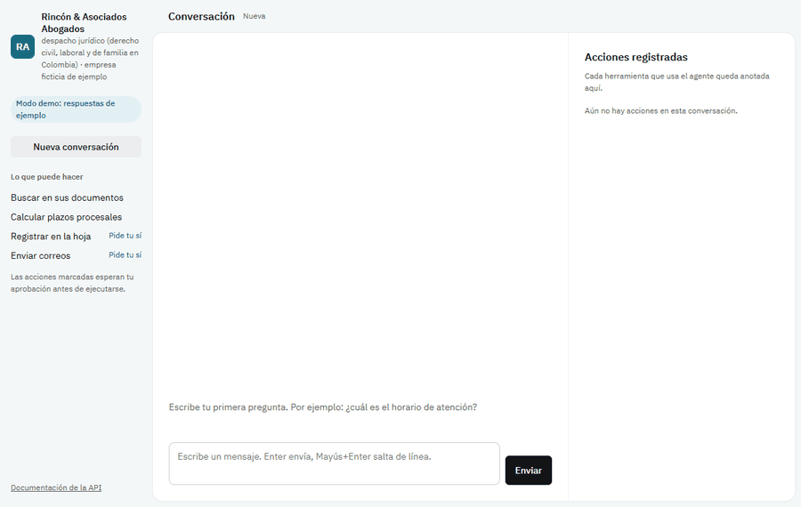

# Agentes IA para Empresas

[](https://github.com/ricardoprs76-max/agentes-ia-empresas/actions/workflows/ci.yml)


[](https://github.com/astral-sh/ruff)
[](LICENSE)

> [Read in English](README.md)

**Un motor, muchas empresas.** Describe una empresa en un solo archivo YAML (nombre,
sector, tono y reglas) y obtén un agente de IA que conversa en español y recuerda cada
conversación, construido con [LangGraph](https://github.com/langchain-ai/langgraph).
Cambia el archivo y el mismo motor atiende a un despacho jurídico, una ferretería o una clínica.

- **Cualquier proveedor:** Google Gemini (gratis), Anthropic Claude u OpenAI, según la configuración.
- **Funciona sin claves:** sin clave de IA arranca en *modo demo*, claramente señalado,
  para que cualquiera lo pruebe en un minuto.
- **Memoria persistente:** cada conversación se guarda en SQLite y sobrevive a reinicios.
- **Respuestas con fuente:** el agente busca en los documentos de la empresa (Markdown, texto,
  PDF) y cita el archivo y la página.
- **Confirmación humana:** las acciones con efectos (anotar en una hoja, enviar un correo)
  esperan un sí o un no, y cada uso de una herramienta queda en un registro de auditoría.
- **Calidad exigente:** `mypy --strict`, `ruff` y pruebas que nunca llaman a una IA real,
  ejecutadas en CI en Linux y Windows.



## Inicio rápido

**Con Docker** (agente, chat web y n8n):

```bash
echo "AGENTES_API_KEY=una-clave-larga-al-azar" > .env
docker compose up --build
# chat web: http://localhost:8000 (pega la clave cuando la pida)   n8n: http://localhost:5678
```

**Con uv** (Python 3.12):

```bash
pip install uv            # si no lo tienes
uv sync
uv run agentes validate configs/tienda.yaml
uv run agentes chat configs/tienda.yaml
```

Para usar un modelo real, copia `.env.example` a `.env` (o exporta la variable) y define
`GOOGLE_API_KEY`; basta una clave gratuita de [Google AI Studio](https://aistudio.google.com/apikey).
`ANTHROPIC_API_KEY` y `OPENAI_API_KEY` funcionan igual. Escribe `salir` para terminar.

## Herramientas y seguridad

| Herramienta | Qué hace | Sin configurar nada | Con variables de entorno |
|-------------|----------|---------------------|--------------------------|
| `buscar_documentos` | Busca en `knowledge_dir` (`.md`, `.txt`, `.pdf`) y devuelve fragmentos con su fuente | Búsqueda por palabras (BM25), sin internet | Embeddings de Gemini con `GOOGLE_API_KEY` |
| `registrar_en_hoja` | Añade una fila | `<data>/hoja.csv` (se abre en Excel) | Google Sheets: `GOOGLE_SERVICE_ACCOUNT_FILE`, `AGENTES_SHEET_ID` |
| `enviar_correo` | Envía un correo | Archivos `.eml` en `<data>/bandeja_salida/` | SMTP: `SMTP_HOST`, `SMTP_PORT`, `SMTP_USER`, `SMTP_PASSWORD`, `SMTP_FROM` |

- El modelo solo ve las herramientas de `tools`; cualquier otra se rechaza.
- Las de `confirm_tools` detienen la conversación hasta que el usuario responde `s` o `n`;
  la pregunta pendiente sobrevive a un reinicio.
- `agentes auditoria CONFIG` muestra cada acción ejecutada, cancelada o fallida.

## Ejemplos por sector

| Configuración | Empresa (ficticia) | Qué muestra |
|---------------|--------------------|-------------|
| `configs/despacho-juridico.yaml` | Rincón & Asociados Abogados | Plazos procesales colombianos (`calcular_plazo`), revisión de contratos cláusula por cláusula, tarifas, registro de casos |
| `configs/tienda.yaml` | Ferretería El Tornillo | Horarios, garantías, domicilios |
| `configs/clinica.yaml` | Clínica Sol del Valle | Preparación de exámenes, convenios, cancelaciones; nunca diagnostica y remite emergencias al 123 |

### Plazos procesales colombianos (`agentes.legal`)

- **Festivos:** fijos, trasladados a lunes por la Ley 51 de 1983 (Ley Emiliani) y los que dependen de la Pascua.
- **Días hábiles (CGP art. 118):** los términos en días cuentan solo días hábiles desde el día siguiente a la notificación.
- **Vacancia judicial:** del 20 de diciembre al 10 de enero y de lunes a miércoles de Semana Santa;
  los términos de tutela sí corren en vacancia.
- **Notificación personal por mensaje de datos (Ley 2213 de 2022 art. 8):** se entiende surtida pasados dos días
  hábiles desde el envío, con la salvedad de la sentencia C-420 de 2020 (acuse de recibo). Solo aplica a términos que
  empiezan con notificación personal (contestación, excepciones); los autos notificados por estado no la tienen.
- **Términos administrativos** (derecho de petición, Ley 1755 de 2015 art. 14): sin fines de semana ni festivos, pero sí corren en vacancia judicial.
- **Catálogo:** reposición (3), apelación de auto y de sentencia (3) —providencias dictadas fuera de audiencia—,
  contestación en verbal (20) y en verbal sumario (10), excepciones en ejecutivo (10), impugnación de tutela (3),
  derecho de petición: general (15), documentos o información (10), consultas (30).

Cada respuesta incluye la advertencia de que es un cálculo orientativo que debe verificarse en el expediente.

**Fuera del alcance (límites conocidos):** despachos que no salen a vacancia colectiva, notificación por aviso
(CGP art. 91) y suspensiones o cierres puntuales de un despacho.

## API HTTP y demo web

```bash
uv run agentes serve configs/despacho-juridico.yaml      # http://127.0.0.1:8000
```

Abre `http://127.0.0.1:8000` para chatear: las acciones pendientes aparecen como un borrador con
los botones **Confirmar / Cancelar** y cada uso de una herramienta queda en *Acciones registradas*.
La documentación interactiva de la API está en `/docs`.

| Método | Ruta | Qué hace |
|--------|------|----------|
| `GET` | `/health` | Empresa, modelo, modo demo y herramientas activas (sin clave) |
| `POST` | `/chat` | `{"message", "thread_id"?}` → respuesta o acción que espera un sí |
| `POST` | `/chat/{thread_id}/confirm` | `{"approved": true\|false}` → ejecuta o cancela la acción |
| `GET` | `/chat/{thread_id}` | Historial de la conversación y acción pendiente |
| `GET` | `/audit?thread_id=&limit=` | Acciones registradas, de la más reciente a la más antigua |

Con `AGENTES_API_KEY` definida, todas las rutas salvo `/health` y la página piden el encabezado
`X-API-Key`. Sin clave, el servidor solo escucha en `127.0.0.1`/`localhost` y rechaza
`--host 0.0.0.0`. Los turnos van de uno en uno: un doble clic nunca ejecuta dos veces la misma
acción (la segunda solicitud recibe `409`); si el modelo falla se responde `502` y la
conversación sigue funcionando.

## Servidor MCP

```bash
uv run agentes mcp configs/despacho-juridico.yaml        # por stdio
```

Cualquier cliente MCP (Claude Desktop, editores) puede usar el agente de la empresa. Herramientas:
`preguntar` (hablar con el agente) y `confirmar` (responder a una acción pendiente), más las de
solo lectura que active la configuración (`buscar_documentos`, `calcular_plazo`), que también
quedan en el registro de auditoría. Las herramientas con efectos nunca se exponen directamente:
solo se ejecutan con `preguntar` → `confirmar`. La configuración para Claude Desktop está en el
[README en inglés](README.md#mcp-server).

## n8n

El agente se conecta a [n8n](https://n8n.io) sin rehacerlo allí: n8n mueve los mensajes y el
agente conserva sus reglas, herramientas, confirmación y registro de auditoría.

- **Nodo propio** [`integrations/n8n/node`](integrations/n8n/node) (TypeScript, CLI oficial de
  nodos de n8n, lint estricto): enviar mensaje, confirmar, ver historial y leer la auditoría.
  Una acción pendiente vuelve en `pending` en lugar de ejecutarse.
- **Plantillas de flujos** [`integrations/n8n/flows`](integrations/n8n/flows): correo → agente
  → registro en Google Sheets y respuesta; WhatsApp → agente → respuesta; y un enlace de
  aprobación (`/webhook/aprobar?conversacion=…&aprobar=si`, con usuario y contraseña) que
  confirma la acción pendiente. Ningún flujo dice que algo se hizo mientras espera aprobación.
- **docker-compose** levanta ambos, con el nodo ya instalado en n8n:

```bash
echo "AGENTES_API_KEY=una-clave-larga-al-azar" > .env   # sin ella compose no arranca
docker compose up --build
# agente y chat web: http://localhost:8000   n8n: http://localhost:5678
# en n8n, la credencial "Agentes IA API" usa la URL http://agente:8000
```

## Configuración de la empresa

| Campo | Obligatorio | Descripción |
|-------|-------------|-------------|
| `id` | sí | Identificador (`a-z`, `0-9`, `-`). |
| `company_name` | sí | Nombre que aparece en las respuestas. |
| `sector` | sí | Sector, p. ej. `despacho jurídico`. |
| `tone` | sí | Cómo debe sonar el agente. |
| `rules` | no | Reglas que el agente debe cumplir. |
| `model.provider` | no | `gemini` (por defecto), `anthropic` u `openai`. |
| `model.model` | no | Nombre del modelo; hay uno por defecto para cada proveedor. |
| `model.temperature` | no | De `0` a `1`; por defecto `0.2`. |
| `tools` | no | Herramientas activas: `buscar_documentos`, `registrar_en_hoja`, `enviar_correo`, `calcular_plazo`. |
| `confirm_tools` | no | Las de `tools` que piden un sí o un no antes de ejecutarse. |
| `knowledge_dir` | no | Carpeta con los documentos de la empresa, relativa al YAML. |

## Hoja de ruta

- [x] **Fase 1 — Núcleo:** configuración, elección de modelo con modo demo, agente LangGraph con memoria, CLI.
- [x] **Fase 2 — Herramientas y seguridad:** consulta de documentos con citas, Sheets y correo, confirmación humana, registro de auditoría.
- [x] **Fase 3 — Ejemplos por sector:** despacho jurídico (plazos legales colombianos), tienda, clínica.
- [x] **Fase 4a — API y demo:** servicio FastAPI con clave de acceso, chat web en español, servidor MCP.
- [x] **Fase 4b — n8n:** plantillas de flujos, nodo propio de n8n en TypeScript, docker-compose.
- [x] **Fase 5 — Presentación:** Docker, GIF de demostración, pulido final.

## Limitaciones conocidas

- Los embeddings de los documentos (con clave de Google) se recalculan en cada arranque.
- La búsqueda por palabras usa raíces: no relaciona *arriendo* con *arrendamiento*
  (los embeddings sí).
- SMTP usa STARTTLS (puerto 587); el puerto 465 con TLS implícito no está soportado.
- En Google Sheets cada fila es libre (una celda `campo: valor` por dato), sin usar los
  encabezados de la hoja; el CSV local añade una columna por cada campo nuevo.
- Con clave de API, `/docs` (OpenAPI) sigue siendo público; sin clave `agentes serve` solo
  escucha en `127.0.0.1`/`localhost` (no `::1`).
- Los plazos procesales son un cálculo orientativo y deben verificarse en el expediente.

## Licencia

[MIT](LICENSE)
