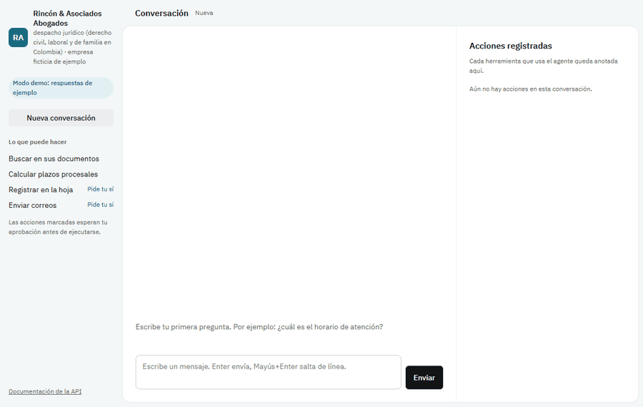

# Agentes IA para Empresas

[](https://github.com/ricardoprs76-max/agentes-ia-empresas/actions/workflows/ci.yml)


[](https://github.com/astral-sh/ruff)
[](LICENSE)

> [Leer en español](README.es.md)

**One engine, many businesses.** Describe a company in a single YAML file — its name,
sector, tone and rules — and get a Spanish-speaking AI agent with persistent memory,
built on [LangGraph](https://github.com/langchain-ai/langgraph). Swap the file and the
same engine serves a law firm, a hardware store or a clinic.

- **Provider-agnostic:** Google Gemini (free tier), Anthropic Claude or OpenAI, chosen in config.
- **Runs with zero keys:** without an API key it starts in a clearly labelled *demo mode*,
  so anyone can try it in a minute.
- **Persistent conversations:** each conversation thread is checkpointed in SQLite and
  survives restarts.
- **Grounded answers:** the agent searches the company's own documents (Markdown, text, PDF)
  and cites the source file and page.
- **Human in the loop:** actions with side effects (writing to a sheet, sending email) wait
  for an explicit yes/no, and every tool call lands in an append-only audit log.
- **Strict quality bar:** `mypy --strict`, `ruff`, and a test suite that never calls a
  real LLM, run in CI on Linux and Windows.



## Quickstart

**With Docker** (agent, web chat and n8n):

```bash
echo "AGENTES_API_KEY=pick-a-long-random-key" > .env
docker compose up --build
# web chat: http://localhost:8000 (paste the key when asked)   n8n: http://localhost:5678
```

**With uv** (Python 3.12):

```bash
pip install uv            # if you don't have it
uv sync
uv run agentes validate configs/tienda.yaml
uv run agentes chat configs/tienda.yaml
uv run agentes chat configs/despacho-juridico.yaml
```

To use a real model, copy `.env.example` to `.env` (or export the variable) and set
`GOOGLE_API_KEY` — a free key from [Google AI Studio](https://aistudio.google.com/apikey)
is enough. `ANTHROPIC_API_KEY` and `OPENAI_API_KEY` work the same way.

```
$ uv run agentes chat configs/tienda.yaml --thread cliente-42
Tú: ¿Hasta qué hora abren el sábado?
Ferretería El Tornillo: Los sábados atendemos de 8:00 a. m. a 2:00 p. m. (Fuente: horarios.md)
Tú: Envíale a ana@ejemplo.com la política de garantías
Acción pendiente: Enviar correo a ana@ejemplo.com con asunto "Política de garantías"
¿Confirmas? (s/n): s
Ferretería El Tornillo: Listo, el correo quedó enviado.
Tú: salir
¡Hasta pronto!

$ uv run agentes auditoria configs/tienda.yaml
2026-10-30 08:11 | cliente-42 | enviar_correo | ejecutada | {"para": "ana@ejemplo.com", ...}
2026-10-30 08:10 | cliente-42 | buscar_documentos | ejecutada | {"consulta": "horario sábado"}
```

## Tools & safety

| Tool | What it does | Default backend (no setup) | Real backend (env vars) |
|------|--------------|----------------------------|-------------------------|
| `buscar_documentos` | Searches `knowledge_dir` (`.md`, `.txt`, `.pdf`) and returns passages with their source | BM25 keyword search, offline | Gemini embeddings when `GOOGLE_API_KEY` is set |
| `registrar_en_hoja` | Appends a row | `<data>/hoja.csv` (opens in Excel) | Google Sheets: `GOOGLE_SERVICE_ACCOUNT_FILE`, `AGENTES_SHEET_ID` |
| `enviar_correo` | Sends an email | `.eml` files in `<data>/bandeja_salida/` | SMTP: `SMTP_HOST`, `SMTP_PORT`, `SMTP_USER`, `SMTP_PASSWORD`, `SMTP_FROM` |

- Only tools listed in `tools` are offered to the model; a call to any other tool is refused.
- Tools listed in `confirm_tools` pause the conversation (a LangGraph `interrupt`) until the
  user answers. The pending question is checkpointed, so it survives a restart.
- Invalid arguments and backend failures become a Spanish message for the model, never a crash.
- `agentes auditoria CONFIG [--thread ID] [--limit N]` lists every executed, cancelled or
  failed action. The log has no edit or delete operations.
- `--data PATH` (default `.agentes/`) holds memory, outbox and sheet.

## Sector examples

| Config | Company (fictional) | What it shows |
|--------|---------------------|---------------|
| `configs/despacho-juridico.yaml` | Rincón & Asociados Abogados | Colombian legal deadlines (`calcular_plazo`), clause-by-clause contract review, fees FAQ, case intake into the sheet |
| `configs/tienda.yaml` | Ferretería El Tornillo | Opening hours, warranties, delivery rules |
| `configs/clinica.yaml` | Clínica Sol del Valle | Exam preparation, insurers, cancellations; never diagnoses, sends emergencies to 123 |

```
$ uv run agentes chat configs/despacho-juridico.yaml
Tú: ¿Cuándo vence la reposición contra el auto notificado el 18/12/2025?
Rincón & Asociados Abogados: Recurso de reposición (CGP art. 318): 3 días hábiles.
Notificación: 18/12/2025. Corre desde 19/12/2025. Vence el 14/01/2026 (miércoles).
Aplica a providencias dictadas fuera de audiencia; si se dictan en audiencia, el recurso se interpone en ella.
Cálculo orientativo: verifique el expediente, suspensiones y días de cierre extraordinario del despacho.
```

### Colombian legal deadlines (`agentes.legal`)

Pure, exhaustively tested functions; the model only picks the procedural action and the date.

- **Holidays:** fixed dates; Ley 51 de 1983 (*Ley Emiliani*) moves seven of them to Monday;
  Holy Thursday/Friday and three Easter-based holidays moved to Monday.
- **Business days (CGP art. 118):** day terms count business days only, from the day after notification.
- **Judicial vacancy:** 20 December – 10 January and Monday–Wednesday of Holy Week; judicial terms do not run,
  except tutela terms, which keep running.
- **Personal notification by data message (Ley 2213 de 2022 art. 8):** done once two business days have passed
  after sending (with the C-420 de 2020 caveat about acknowledgement of receipt). It only applies to terms that
  start with a personal notification (answering a claim, exceptions); autos notified by *estado* do not get it.
- **Administrative terms** (derecho de petición, Ley 1755 de 2015 art. 14) skip weekends and holidays but not the judicial vacancy.
- **Catalogue:** reposición (3), apelación de auto/sentencia (3) — for decisions issued outside a hearing —,
  contestación verbal (20) and verbal sumario (10), excepciones en ejecutivo (10), impugnación de tutela (3),
  derecho de petición: general (15), documents/information (10), consultation (30).

Every answer carries a disclaimer: it is an orientative calculation to be checked against the case file.

**Out of scope (known limits):** courts that do not take the collective vacancy (they work during it),
notification by *aviso* (CGP art. 91), ad hoc suspensions or closures of a specific court.

## HTTP API and web demo

```bash
uv run agentes serve configs/despacho-juridico.yaml      # http://127.0.0.1:8000
```

Open `http://127.0.0.1:8000` for the Spanish chat: pending actions appear as a draft with
**Confirmar / Cancelar** buttons and every tool call shows up under *Acciones registradas*.
Interactive OpenAPI docs live at `/docs`.

| Method | Route | What it does |
|--------|-------|--------------|
| `GET` | `/health` | Company, model, demo mode, enabled tools (no key needed) |
| `POST` | `/chat` | `{"message", "thread_id"?}` → reply, or the action waiting for a yes |
| `POST` | `/chat/{thread_id}/confirm` | `{"approved": true\|false}` → runs or cancels the pending action |
| `GET` | `/chat/{thread_id}` | Conversation history and pending action |
| `GET` | `/audit?thread_id=&limit=` | Tool calls, newest first |

Set `AGENTES_API_KEY` to require the header `X-API-Key` on every route except `/health` and the
page itself. Without a key the server only listens on `127.0.0.1`/`localhost` and refuses
`--host 0.0.0.0`. Turns are serialised, so a double click never runs an action twice (the
second request gets `409`); model failures return `502` and the conversation stays usable.

```bash
curl -s localhost:8000/chat -H "Content-Type: application/json" \
  -d '{"message": "Manda un correo al cliente", "thread_id": "demo"}'
# → {"thread_id":"demo","reply":"","pending":{"tool":"enviar_correo", ...}}
curl -s localhost:8000/chat/demo/confirm -H "Content-Type: application/json" \
  -d '{"approved": true}'
```

## MCP server

```bash
uv run agentes mcp configs/despacho-juridico.yaml        # stdio transport
```

Any MCP client (Claude Desktop, IDEs) can use the company's agent. Tools: `preguntar`
(talk to the agent) and `confirmar` (answer a pending action), plus the read-only tools the
config enables (`buscar_documentos`, `calcular_plazo`), which are recorded in the audit log
like any other call. Side-effecting tools are never exposed directly: they only run through
`preguntar` → `confirmar`. Claude Desktop config (`claude_desktop_config.json`):

```json
{
  "mcpServers": {
    "despacho": {
      "command": "uv",
      "args": ["--directory", "/path/to/agentes-ia-empresas", "run",
               "agentes", "mcp", "configs/despacho-juridico.yaml"]
    }
  }
}
```

## n8n

The agent plugs into [n8n](https://n8n.io) without being rebuilt there: n8n moves messages
in and out, the agent keeps its rules, tools, confirmation step and audit log.

- **Custom node** [`integrations/n8n/node`](integrations/n8n/node) (TypeScript, built with
  n8n's official node CLI, lint in strict mode): *Send Message*, *Confirm*, *Get History* and
  *Audit → Get Many*. A pending action comes back in `pending` instead of running. Usable as a
  tool by n8n's own AI agents. Install it in a self-hosted n8n with
  `N8N_CUSTOM_EXTENSIONS=/path/to/integrations/n8n/node` after `npm ci && npm run build`.
- **Flow templates** [`integrations/n8n/flows`](integrations/n8n/flows): email → agent →
  Google Sheets log + reply; WhatsApp → agent → reply; an approval link
  (`/webhook/aprobar?conversacion=…&aprobar=si`, behind Basic Auth) that confirms the pending
  action. A flow never claims an action happened while it is waiting for approval.
- **docker-compose** runs both, with n8n's node preinstalled:

```bash
echo "AGENTES_API_KEY=pick-a-long-random-key" > .env   # compose refuses to start without it
docker compose up --build
# agent + web chat: http://localhost:8000   n8n: http://localhost:5678
# in n8n, the "Agentes IA API" credential uses base URL http://agente:8000
```

## Company config

| Field | Required | Description |
|-------|----------|-------------|
| `id` | yes | Slug (`a-z`, `0-9`, `-`). |
| `company_name` | yes | Shown in replies and in the system prompt. |
| `fictitious` | no | `true` for example companies; the web chat says so. |
| `sector` | yes | Business sector, e.g. `despacho jurídico`. |
| `tone` | yes | How the agent should sound. |
| `rules` | no | List of rules the agent must follow. |
| `model.provider` | no | `gemini` (default), `anthropic` or `openai`. |
| `model.model` | no | Model name; a sensible default per provider. |
| `model.temperature` | no | `0`–`1`, default `0.2`. |
| `tools` | no | Enabled tools: `buscar_documentos`, `registrar_en_hoja`, `enviar_correo`, `calcular_plazo`. |
| `confirm_tools` | no | Subset of `tools` that needs a human yes/no before running. |
| `knowledge_dir` | no | Folder with the company's documents, relative to the YAML. |

Unknown fields are rejected, and every config error is reported as one clear line.

## Development

```bash
uv run pytest          # tests (no network, no API keys)
uv run ruff check .    # lint
uv run ruff format .   # format
uv run mypy            # strict type checking
```

Architecture overview: [docs/architecture.md](docs/architecture.md).

## Roadmap

- [x] **Phase 1 — Core:** config schema, provider factory with demo mode, LangGraph agent with memory, CLI.
- [x] **Phase 2 — Tools & safety:** RAG over company documents with citations, Sheets and email tools, human-in-the-loop confirmation, audit log.
- [x] **Phase 3 — Sector examples:** law firm (Colombian legal deadlines), shop, clinic.
- [x] **Phase 4a — API & demo:** FastAPI service with API-key auth, Spanish web chat, MCP server.
- [x] **Phase 4b — n8n:** flow templates, a custom TypeScript n8n node, docker-compose.
- [x] **Phase 5 — Presentation:** Docker, demo GIF, final polish.

## Known limitations

- Document embeddings (with a Google key) are recomputed at every start; there is no cache.
- Keyword search is stem-based: it does not relate words with different stems such as
  *arriendo* and *arrendamiento* (embeddings do).
- SMTP uses STARTTLS (port 587); implicit TLS on port 465 is not supported.
- Google Sheets rows are free-form (one `campo: valor` per cell), not mapped to the
  sheet's header; the local CSV adds a column for every new field.
- With an API key set, `/docs` (OpenAPI) stays public; without a key `agentes serve` only
  binds to `127.0.0.1`/`localhost` (not `::1`).
- Legal deadlines are an orienting calculation (see the legal section) and must be checked
  against the case file.

## License

[MIT](LICENSE)
