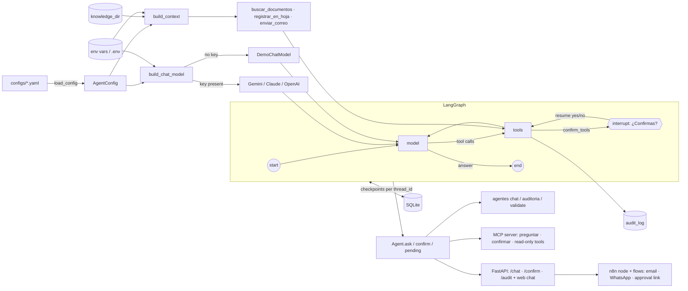

# Architecture

| Module | Responsibility |
|--------|----------------|
| `agentes.config` | Pydantic schema for a company, YAML loading with one-line Spanish errors. |
| `agentes.llm` | Chooses the chat model; falls back to a deterministic offline demo model that can also call tools. |
| `agentes.rag` | Loads `.md`/`.txt`/`.pdf` into chunks; BM25+ search offline, embeddings with a key; formats cited passages. |
| `agentes.legal` | Colombian holidays, business-day arithmetic (CGP art. 118, judicial vacancy, Ley 2213) and the procedural-term catalogue behind `calcular_plazo`. |
| `agentes.integrations` | Sheet (CSV / Google Sheets) and email (outbox / SMTP) backends. |
| `agentes.tools` | Builds only the tools a config enables, wired to their backends. |
| `agentes.audit` | Append-only SQLite log of every tool call and its outcome. |
| `agentes.graph` | The LangGraph state graph: model node, tools node with confirmation interrupts. |
| `agentes.agent` | Facade: `ask`, `confirm`, `pending`, `history`, `run_tool` (read-only tools only); owns the SQLite connections. |
| `agentes.api` | FastAPI app around one open `Agent`: API-key auth, one turn at a time, static Spanish web chat. |
| `agentes.mcp` | MCP server (official SDK): the agent behind `preguntar`/`confirmar`, read-only tools exposed directly. |
| `integrations/n8n` | TypeScript n8n node over the HTTP API, importable flow templates, n8n image with the node preinstalled (used by `docker-compose.yml`). |
| `agentes.cli` | Typer commands (`chat`, `serve`, `mcp`, `auditoria`, `validate`); forces UTF-8 for Windows consoles. |

Design decisions:

- **Every surface keeps the same safety** — the CLI, the HTTP API, the web chat and the MCP
  server all go through `Agent`, so side effects always stop at the same confirmation and land
  in the same audit log. MCP never exposes a side-effecting tool directly.
- **n8n as plumbing, not as the agent** — flows only call the HTTP API through the custom
  node; the agent is never rebuilt with n8n's LLM nodes, so its rules, confirmation and audit
  log apply to email and WhatsApp too. Conversation ids are derived from the sender and
  sanitised to the API's pattern, and the approval webhook needs Basic Auth because those
  ids are guessable.
- **One turn at a time in the API** — a lock around every agent call makes a double click on
  "Confirmar" a `409` instead of a second email, and keeps SQLite checkpoints consistent.

- **Graph over a plain chain** — tool use and human confirmation are just more nodes and an
  `interrupt`, and the checkpointer gives persistence for free.
- **All confirmations before any execution** — LangGraph re-runs an interrupted node from the
  top when it resumes. The tools node asks for every confirmation first and only then executes,
  so resuming can never repeat an email or a sheet row.
- **Arguments validated before asking** — the user is never asked to approve a call that would
  fail on its own arguments.
- **BM25+ offline fallback** — RAG must work without any key; BM25+ keeps scores positive for
  tiny corpora (a company with one document) and Spanish stopwords are dropped.
- **Legal rules as pure functions** — holidays and deadlines are plain, exhaustively tested
  date arithmetic; the model only chooses the procedural action and the date, so it cannot
  miscount days.
- **Spanish stemming in keyword search** — "incumplo" must find "incumple"; snowball stemming
  plus stopword removal keeps the offline search useful for real questions.
- **Separate SQLite connection for the audit log** — the checkpointer commits from LangGraph's
  worker threads; sharing its connection raced.
- **Demo model instead of failing without a key** — the project must be runnable by anyone who
  clones it, and tests must never depend on the network.
