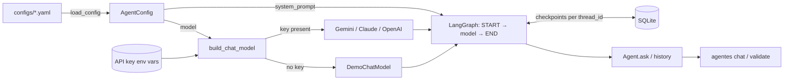

# Architecture

| Module | Responsibility |
|--------|----------------|
| `agentes.config` | Pydantic schema for a company, YAML loading with one-line Spanish errors. |
| `agentes.llm` | Chooses the chat model; falls back to a deterministic offline demo model. |
| `agentes.graph` | Builds the LangGraph state graph. The system prompt is injected per call, never stored, so config edits apply to existing conversations. |
| `agentes.agent` | Facade owning the SQLite checkpointer; one `thread_id` per conversation. |
| `agentes.cli` | Typer commands; forces UTF-8 output for Windows consoles. |

Design decisions:

- **Graph over a plain chain** — Phase 2 adds a `tools` node and a human-confirmation
  interrupt to the same graph; node names are stable for that reason.
- **Demo model instead of failing without a key** — the project must be runnable by anyone
  who clones it, and tests must never depend on the network.
